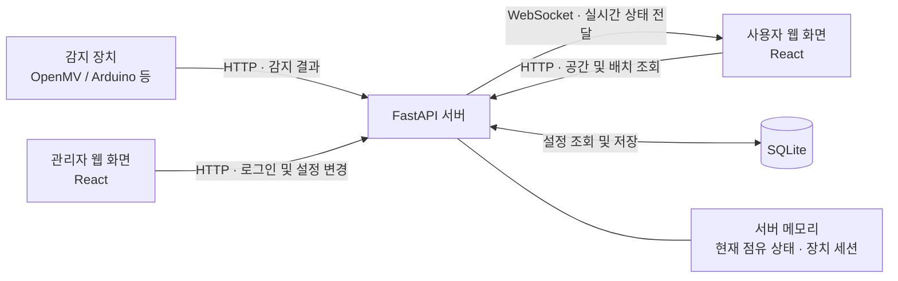
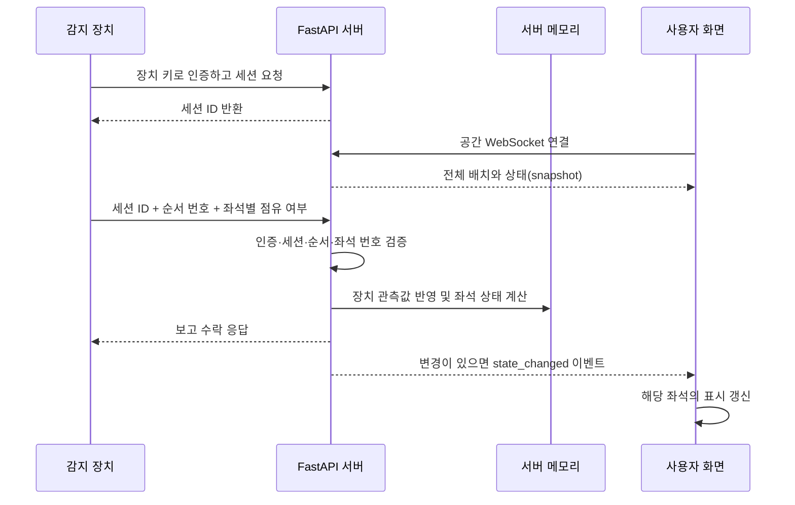
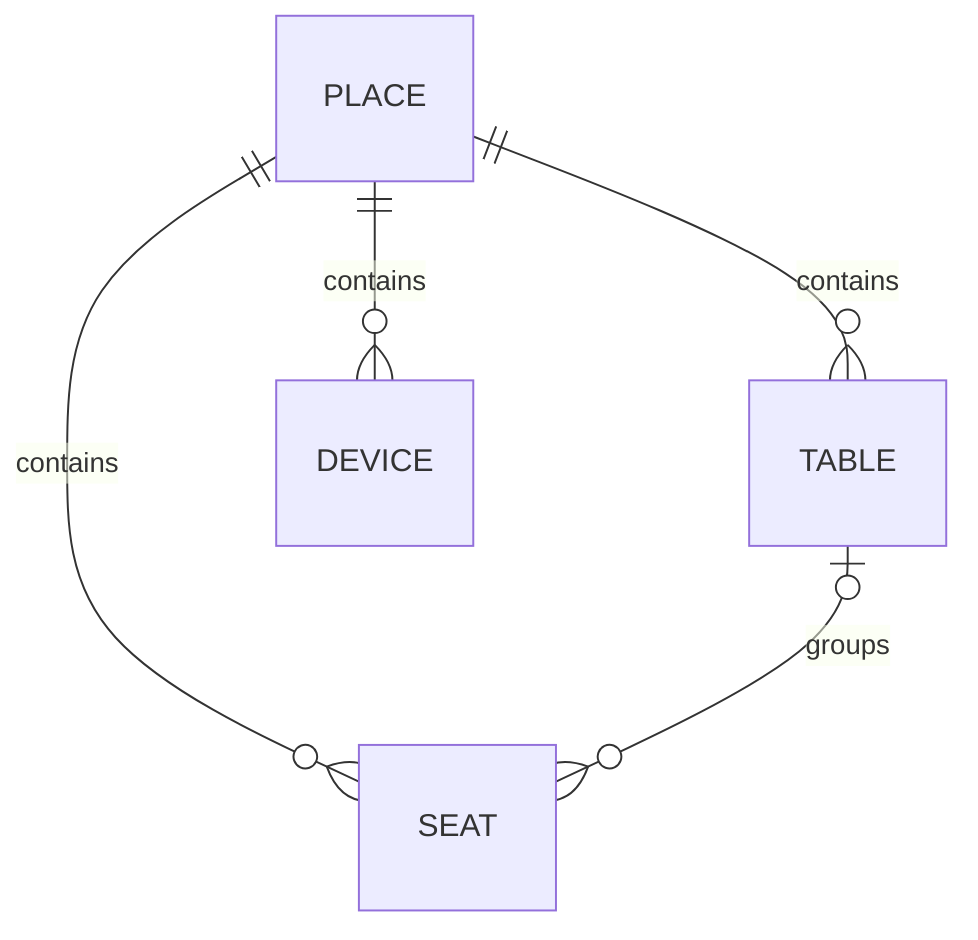

# Comsigi — 실시간 좌석 현황 서비스

> 화면 서비스명: **빈자리**  
> 발표 주제: 프로그램의 전체 구조와 데이터가 흐르는 방식  
> 구성: 약 7~10분 발표를 위한 12개 슬라이드

---

## 01. 어떤 프로그램인가요?

**공간에 직접 가기 전에, 이용 가능한 좌석을 웹에서 확인하는 서비스입니다.**

- 사용자는 공간을 선택하고 배치도나 번호순 목록에서 좌석 상태를 확인합니다.
- 관리자는 공간, 좌석 배치, 감지 장치를 등록하고 수정합니다.
- 감지 장치가 보낸 결과를 화면에 실시간으로 반영합니다.

좌석은 `이용 가능`, `사용 중`, `확인 불가`의 세 가지 상태로 표시합니다.

**발표 멘트**  
“빈자리는 좌석을 찾기 위해 직접 돌아다니는 수고를 줄여주는 서비스입니다. 사용자는 웹 화면에서 공간별 좌석 현황을 확인할 수 있습니다.”

---

## 02. 전체 구조 한눈에 보기



| 구성 요소 | 주요 역할 |
| --- | --- |
| 감지 장치 | 좌석 점유 여부를 판단하고 서버에 보고 |
| 프론트엔드 | 공간 목록, 좌석 현황, 관리자 화면 제공 |
| 백엔드 | 인증, 데이터 검증, 상태 계산, 실시간 전송 |
| 데이터베이스 | 공간·좌석·장치·관리자 설정 보관 |

**발표 멘트**  
“전체 시스템은 감지 장치, 웹 화면, 서버, 데이터베이스로 구성됩니다. 장치가 감지 결과를 보내면 서버가 상태를 계산하고, 연결된 사용자 화면에 전달합니다.”

---

## 03. 사용 기술과 선택 목적

| 영역 | 기술 | 사용 목적 |
| --- | --- | --- |
| 웹 화면 | React 19, TypeScript | 화면을 구성하고 데이터 타입 관리 |
| 프론트엔드 개발·빌드 | Vite | 개발 서버 실행 및 배포 파일 생성 |
| 서버 | Python, FastAPI | 공개 조회·관리·장치 API 제공 |
| 서버 실행 | Uvicorn | HTTP와 WebSocket 연결 처리 |
| DB 접근 | SQLAlchemy, aiosqlite | 비동기 방식으로 SQLite 접근 |
| 데이터 저장 | SQLite | 별도 DB 서버 없이 설정 저장 |
| DB 구조 관리 | Alembic | 테이블 생성 및 스키마 변경 관리 |
| 실시간 통신 | WebSocket | 연결을 유지하며 변경 이벤트 전달 |

**핵심 설계:** 설정을 저장하는 처리와 반복적으로 들어오는 감지 결과 처리를 구분합니다.

---

## 04. 프로그램 폴더 구조

```text
comsigi/
├─ frontend/src/          웹 화면과 서버 연결
│  ├─ Application.tsx     전체 화면 구성
│  ├─ PlaceFinder.tsx     공간 검색 및 좌석 조회
│  ├─ SpatialMap.tsx      좌석·테이블 배치도 표시
│  ├─ admin/             공간·배치·장치 관리 화면
│  ├─ backend.ts         실제 서버 API 연결
│  ├─ backend-contract.ts 서버 응답 검증 및 화면 데이터 변환
│  └─ realtime.ts        실시간 이벤트 반영 및 재연결
├─ app/                  백엔드
│  ├─ main.py            서버 초기화 및 API 연결
│  ├─ models.py          DB 테이블 정의
│  ├─ schemas.py         요청·응답 데이터 형식 검증
│  ├─ security.py        관리자·장치 인증
│  ├─ realtime.py        현재 상태 계산 및 이벤트 전송 관리
│  └─ api/               공개·관리자·장치 API
├─ alembic/              DB 구조 변경 이력
├─ scripts/              장치 시뮬레이터
├─ tests/                백엔드 및 통합 테스트
└─ docs/                 API 및 발표 문서
```

**발표 멘트**  
“프론트엔드는 화면과 서버 연결을 담당하고, 백엔드는 API와 상태 처리 로직으로 나뉩니다. 특히 실시간 상태 처리의 중심은 백엔드의 realtime.py입니다.”

---

## 05. 사용자 화면은 어떻게 동작하나요?

1. 웹에 접속해 공간 목록을 불러옵니다.
2. 원하는 공간을 선택하면 좌석 배치와 현재 상태를 조회합니다.
3. 해당 공간의 WebSocket에 연결해 전체 상태를 동기화합니다.
4. 이후 전달되는 변경 이벤트를 화면에 반영합니다.
5. 연결이 끊기면 재연결을 시도하고, 복구 후 전체 상태를 다시 받습니다.

| 화면 기능 | 설명 |
| --- | --- |
| 공간 탐색 | 이용하려는 공간 선택 |
| 좌석 배치도 | 실제 공간의 좌석·테이블 위치 확인 |
| 번호순 보기 | 좌석 번호 기준으로 상태 확인 |
| 즐겨찾기 | 자주 확인하는 공간 모아 보기 |
| 연결 상태 표시 | 서버 연결 상태와 감지 시각 확인 |

**좌석 선택은 예약 기능이 아닙니다.** 현재 구현은 감지된 좌석 현황을 제공합니다.

---

## 06. 장치에서 화면까지의 처리 순서



장치는 이미지 자체가 아니라 **장치 식별자, 세션 ID, 순서 번호, 좌석 번호와 점유 여부**를 전송합니다.

**발표 멘트**  
“영상 분석은 장치 측에서 수행한다는 전제입니다. 서버는 분석 결과를 받아 검증하고, 여러 장치의 관측값을 종합해 사용자에게 보여줄 상태를 결정합니다.”

---

## 07. 좌석 상태는 어떻게 판단하나요?

| 상태 | 의미 | 판정 기준 |
| --- | --- | --- |
| `available` | 이용 가능 | 유효한 보고들이 모두 비점유 |
| `occupied` | 사용 중 | 유효한 보고 중 하나라도 점유 |
| `unknown` | 확인 불가 | 유효한 보고가 없음 |

- 같은 좌석을 여러 장치가 보고하면, 온라인 장치의 만료되지 않은 관측값을 종합합니다.
- 기본 설정에서 장치가 30초 동안 메시지를 보내지 않으면 `offline`으로 처리합니다.
- 좌석별 보고도 기본 30초가 지나면 유효성을 잃으며, 만료 검사는 기본 1초 간격으로 수행합니다.
- heartbeat는 장치 연결만 유지합니다. 좌석 정보는 상태가 같아도 주기적으로 다시 보고해야 합니다.
- 브라우저가 서버와 연결되지 않은 동안에는 좌석을 `unknown`으로 표시합니다.

**예시:** 장치 A는 “비어 있음”, 장치 B는 “사용 중”이라고 유효하게 보고했다면, 최종 상태는 `occupied`입니다.

**발표 멘트**  
“감지 정보가 끊겼다고 빈자리로 처리하지 않습니다. 확인할 수 없는 상태를 별도로 표시해, 오래된 정보를 빈자리로 오해하지 않도록 했습니다.”

---

## 08. DB와 메모리에는 무엇을 저장하나요?

| 구분 | 저장 내용 | 서버 재시작 후 |
| --- | --- | --- |
| SQLite | 공간, 좌석, 테이블, 위치·크기·회전, 배치 버전 | 유지 |
| SQLite | 장치 소속·활성 여부·인증 키 해시, 관리자 계정·비밀번호 해시 | 유지 |
| 서버 메모리 | 현재 점유 상태, 수신 시각, 장치 온라인 상태 | 초기화 |
| 서버 메모리 | 장치 세션, 보고 순서 번호, 관리자 로그인 세션, WebSocket 연결 | 초기화 |

**이렇게 나눈 이유**

- 유지해야 하는 설정은 DB에 저장합니다.
- 자주 바뀌는 감지 결과는 메모리에서 처리합니다.
- 장치 보고 처리 경로에서는 DB 조회나 쓰기를 수행하지 않습니다.

재시작 후 좌석은 `unknown`, 활성 장치는 `offline`에서 시작합니다. 새 보고를 받으면 상태가 갱신됩니다.

**설계상 제약:** 현재 구조는 실시간 메모리를 공유하지 않으므로 서버 프로세스와 replica를 각각 1개로 운영합니다.

---

## 09. 관리자 기능과 데이터 관계



- **공간 관리:** 공간 이름, 설명, 주소용 식별자(slug), 배치도 크기 설정
- **배치 관리:** 좌석·테이블 생성, 이동, 크기·회전 변경, 좌석과 테이블 연결
- **장치 관리:** 장치 등록, 소속 공간 지정, 활성화·비활성화, 인증 키 교체
- **인증 관리:** 관리자 로그인과 로그아웃

배치 버전으로 오래된 배치를 덮어쓰는 충돌을 검사합니다. 다만 좌석·테이블 추가·삭제가 포함된 저장은 여러 API 요청으로 진행되므로, 전체 작업이 한 번에 저장되는 것은 아닙니다.

좌석 생성·삭제·번호 변경은 해당 공간의 장치 세션과 관측값을 초기화합니다. 장치는 새 세션을 열고 다시 보고해야 합니다.

**발표 멘트**  
“관리자가 공간과 배치를 먼저 등록하고, 장치를 해당 공간에 연결합니다. 좌석 번호가 바뀌면 이전 번호를 기준으로 한 보고가 섞이지 않도록 세션을 초기화합니다.”

---

## 10. 통신과 오류 복구 방식

| 상황 | 처리 방식 |
| --- | --- |
| 일반 사용자 조회 | 인증 없이 공개 조회 API 사용 |
| 관리자 설정 변경 | 관리자 Bearer 토큰 검증 |
| 장치 보고 | 장치별 Bearer 키와 세션 검증 |
| 오래되거나 중복된 보고 | 순서 번호를 비교해 중복과 순서 역전 구분 |
| 실시간 연결 시작 | `snapshot`으로 전체 배치와 상태 수신 |
| 좌석·장치 상태 변경 | `state_changed`로 변경 내용 전달 |
| 배치 변경 | `layout_changed`로 전체 배치와 상태 전달 |
| 이벤트 누락·서버 재시작 감지 | 새 연결에서 전체 스냅샷으로 재동기화 |
| 네트워크 연결 실패 | 재시도 간격을 늘리며 자동 재연결 |

관리자 비밀번호는 Argon2id, 장치 키는 SHA-256 해시로 저장합니다. 장치 키 원문은 발급·교체 응답에서 한 번만 제공합니다.

**발표 멘트**  
“연결 복구 시에는 전체 상태를 다시 받아 기준을 맞춥니다. 장치 보고에도 세션과 순서 번호를 두어 이전 연결의 오래된 보고가 반영되지 않도록 합니다.”

---

## 11. 실행 구성과 시연 순서

운영 배포에서는 React 빌드 결과를 FastAPI가 함께 제공하므로, 하나의 주소에서 화면과 API에 접근합니다. 저장소에는 Railway 배포 설정이 포함되어 있습니다.

| 접근 위치 | 용도 |
| --- | --- |
| `/` | 사용자 좌석 현황 화면 |
| `/#/admin/login` | 관리자 로그인 |
| `/docs` | 자동 생성 API 문서 |
| `/api/v1/ready` | DB와 만료 처리 작업의 준비 상태 확인 |

**시연 순서**

1. 관리자 로그인 후 공간을 생성합니다.
2. 배치 편집기에서 테이블과 좌석을 배치하고 저장합니다.
3. 해당 공간에 장치를 등록하고 발급된 인증 키를 설정합니다.
4. 실제 장치 또는 `scripts/simulate_device.py`로 보고를 전송합니다.
5. 사용자 화면에서 좌석 상태가 바뀌는 모습을 확인합니다.
6. 보고를 중단하고 기본 만료 시간 이후 `unknown` 전환을 확인합니다.

시뮬레이터도 실제 서버의 인증·세션·HTTP API를 사용합니다. 실행 절차는 [README](../README.md#하드웨어-없이-연동-검증)를 참고합니다.

---

## 12. 현재 구현 범위와 확장 방향

| 현재 구현 | 향후 확장 아이디어 |
| --- | --- |
| 공간별 좌석 조회와 실시간 갱신 | 이용 패턴과 혼잡도 분석 |
| 관리자 공간·배치·장치 관리 | 관리자 권한 세분화 |
| 장치 보고 검증과 통신 만료 처리 | 실제 센서·카메라 환경에서 감지 정확도 검증 |
| 설정 영구 저장과 메모리 기반 상태 처리 | 공유 상태 저장소를 통한 서버 다중화 |

현재 저장소는 영상 수신·이미지 분석, 점유 이력 저장, 좌석 예약을 구현하지 않습니다. 위 확장 아이디어는 현재 기능과 구분합니다.

**마무리 멘트**  
“이 프로그램의 핵심은 장치에서 얻은 감지 결과를 검증하고, 공간별 좌석 상태로 정리해 웹 화면에 실시간으로 전달하는 것입니다. 설정은 유지하면서도 오래되거나 확인할 수 없는 감지 정보는 별도로 표시하도록 구성했습니다.”

---

## 발표 준비용 참고 자료

- [실행·배포 및 백엔드 구조](../README.md)
- [API와 WebSocket 계약](API.md)
- [프론트엔드 실행 방법](../frontend/README.md)
- [프론트엔드·백엔드 연동과 저장 보장 범위](../frontend/INTEGRATION.md)

이 문서는 현재 저장소의 코드를 기준으로 작성했습니다. Mermaid를 지원하는 Markdown 뷰어에서 구조도와 순서도가 표시됩니다.
